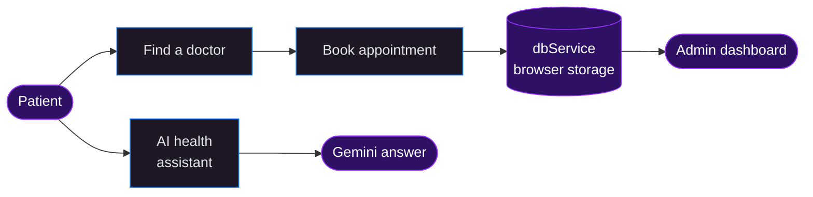

<!-- styled:v2 -->
<div align="center">


**A hospital web app for patients, doctors and admins: appointment booking, doctor profiles, online reports, live consultation and a Gemini-powered health assistant.**

<p>
  
  
  
  
</p>

<p>
  <a href="#overview">Overview</a> ·
  <a href="#how-it-works">How it works</a> ·
  <a href="#features">Features</a> ·
  <a href="#tech-stack">Tech stack</a> ·
  <a href="#getting-started">Getting started</a>
</p>

</div>

---

## Overview

Built for a private hospital in Rahim Yar Khan, Pakistan. Patients can find a doctor, book an appointment, download reports and ask an AI assistant general health questions, while staff manage everything from an admin dashboard.

## Features

| Area | Pages |
|:--|:--|
| 🩺 **Patients** | Appointment booking, doctor profiles, online reports, patient dashboard, edit profile, feedback |
| 🤖 **AI** | Health assistant (Gemini 2.5 Flash), video studio (Veo) |
| 📹 **Care** | Live consultation with PDF summary export (jsPDF + html2canvas), ambulance service, international patients |
| 🏥 **Hospital** | Services, doctors, gallery, blog, careers, about and contact |
| 🛡️ **Admin** | Admin dashboard and login |

## How it works



Data is stored in the browser through `services/dbService.ts`, so the app runs as a front-end demo without a backend.

## Tech stack

| Area | Tools |
|:--|:--|
| UI | React, TypeScript, React Router |
| AI | Google Gen AI SDK (`gemini-2.5-flash`, Veo) |
| Documents | jsPDF, html2canvas |
| Build | Vite |

## Getting started

```bash
npm install
echo "GEMINI_API_KEY=your_key" > .env.local
npm run dev
```

> The AI assistant gives general information only and does not replace a doctor.

---

<div align="center">

**Built by [Ch Muhammad Samiullah](https://github.com/samiullah156-creator)** · AI Automation Engineer and Full-Stack Developer at [Lexvaxa](https://lexvaxa.com)

<a href="https://github.com/samiullah156-creator"></a>
<a href="https://lexvaxa.com/contact"></a>
<a href="https://www.linkedin.com/in/sami-lexvaxa/"></a>

<sub>⭐ Star this repo if you found it useful</sub>

</div>


